# 🇩🇪 EduRoute — German Higher Education & Career Migration Platform 🇮🇳

<p align="center">
  
</p>

<p align="center">
  <strong>An AI-Augmented, Agentic Journey for Indian Students and Professionals Moving to Germany</strong>
</p>

<p align="center">
  <a href="#-quick-start"></a>
  <a href="#-tech-stack--monorepo-architecture"></a>
  <a href="#-tech-stack--monorepo-architecture"></a>
  <a href="#-tech-stack--monorepo-architecture"></a>
  <a href="https://github.com/IshanshuShekhar/Idea/blob/main/LICENSE"></a>
</p>

---

## 📖 Table of Contents

- [Overview](#-overview)
- [Key Innovations & Hard Architectural Rules](#-key-innovations--hard-architectural-rules)
- [The 10-Step Applicant Journey](#-the-10-step-applicant-journey)
- [Consultant & Advisor Ecosystem](#-consultant--advisor-ecosystem)
- [Tech Stack & Package Ecosystem](#-tech-stack--package-ecosystem)
- [Monorepo Architecture](#-monorepo-architecture)
- [Quick Start](#-quick-start)
- [Environment Variables](#-environment-variables)
- [Testing & Quality Verification](#-testing--quality-verification)
- [Contributing & License](#-contributing--license)

---

## 🌟 Overview

**EduRoute** (formerly Educaro Applicant Journey) is an end-to-end platform engineered to navigate the complex German academic and vocational immigration system for Indian applicants. Moving from India to Germany involves intricate bureaucracy: **Anabin database degree recognition**, **APS certificate verification**, **Modified Bavarian Formula GPA conversion**, **€11,904 blocked account (Sperrkonto) compliance**, **CEFR language requirements (Goethe/TestDaF)**, and **residence registration (Anmeldung)**.

EduRoute solves this by pairing a **deterministic rules engine** with **responsible autonomous AI agents**. Applicants receive a hyper-personalized, transparent, step-by-step roadmap tailored to their profile — whether they are aiming for **Direct Master's/Bachelor's Study**, **Studienkolleg Foundation Courses**, **Dual Vocational Training (Ausbildung)**, or **Direct Employment (EU Blue Card / Opportunity Card - Chancenkarte)**.

```mermaid
flowchart LR
    A["👤 Indian Applicant"] --> B["🌐 3D Interactive Portal"]
    B --> C["📋 Comprehensive Profile"]
    C --> D["📂 Document Vault & OCR"]
    D --> E["⚖️ Anabin & Bavarian Formula Engine"]
    E --> F["🎯 Program & Scholarship Matching"]
    F --> G["💶 Financial Reality Simulator"]
    G --> H["📅 Visa & Intake Roadmap"]
    H --> I["🇩🇪 Exam Prep & Culture Guide"]
    I --> J["🎓 Arrival & Enrollment in Germany"]
```



---

## 🏛 Key Innovations & Hard Architectural Rules

EduRoute enforces four core engineering pillars to eliminate AI hallucinations and ensure complete trustworthiness for visa and academic counseling:

### 1. 🛡️ Strict Data Provenance Enforcement
Every profile attribute is explicitly tagged with a provenance label throughout the database, API, and UI:
* `VERIFIED` — Formally confirmed by official documentation or human counselor.
* `APPLICANT_PROVIDED` — Directly submitted by the applicant.
* `AI_EXTRACTED` — Extracted from uploaded documents (transcripts, certificates, passports) via OCR / LLM.
* `AI_GENERATED` — Inferred or synthesized by an AI assistant.

> [!IMPORTANT]
> **Zero-Trust Rule**: The AI service is programmatically restricted from assigning the `VERIFIED` status to any field. Only human administrators or verified institutional APIs can certify data.

### 2. 🧮 Deterministic Academic Rules Engine
Eligibility, GPA translations, and pathways are evaluated using verified legal formulas and official databases:
* **Modified Bavarian Formula**: Deterministic German GPA calculation:
  $$N_v = 1 + 3 \times \frac{N_{max} - N_d}{N_{max} - N_{min}}$$
* **Anabin Institutional Validation**: Database-backed matching of Indian degree awarding institutions ($H+$, $H-$, $H+/-$).
* **APS & ECTS Requirement Checks**: Direct gatekeeping ensuring applicants meet minimum curricular credits.

### 3. 🔍 Live Agent Trace & Audit Trail
Every background agent operation writes an immutable record to the `agent_events` ledger:
* Real-time streaming in the collapsible **Agent Trace Panel** (`AgentTracePanel.tsx`).
* Logs the exact agent name, tool invocations, raw parameters, returned output, latency, and confidence score.

### 4. 💶 Real-World Financial Clarity (No Gimmicks)
* Real-time blocked account calculator aligned with German Federal Ministry of the Interior regulations (**€11,904 standard**).
* City-by-city rental and living cost matrix (Munich, Berlin, Frankfurt, Stuttgart, Aachen, Leipzig, Hamburg).
* Direct dual-currency conversions (**EUR €** and **INR ₹**).

---

## 🗺 The 10-Step Applicant Journey

EduRoute organizes the entire relocation lifecycle into a strict, distraction-free 10-step progression:

| Step | Page Route | Title | Key Features & Functionality |
| :---: | :--- | :--- | :--- |
| **0** | `/` | **Interactive Portal & Hero** | 3D interactive Earth globe (Three.js & R3F), destination route tracing, city spotlights, trust metrics. |
| **1** | `/journey/details` | **Comprehensive Profile** | 9-section modular form: Personal Info, Education, Exams, Skills, Preferences, Sports & ECA, Honors, Accessibility, and Review. Real-time completeness %, draft saving. |
| **2** | `/journey/documents` | **Document Vault** | Multi-file uploader, Tesseract OCR transcript extraction, passport parsing, side-by-side authenticity audit. |
| **3** | `/journey/qualification` | **Qualification Evaluation** | Automatic Bavarian grade conversion, Anabin $H+$ accreditation check, APS readiness report, and pathway assignment. |
| **4** | `/journey/recommendations` | **University & Program Match** | AI & rule-driven program recommendations, DAAD criteria matching, ECTS alignment, English/German language check. |
| **5** | `/journey/scholarships` | **Scholarship Matching** | Real-time scholarship finder (DAAD, Deutschlandstipendium, Heinrich Böll Foundation, Erasmus+) filtered by merit and financial profile. |
| **6** | `/journey/financial-simulator` | **Financial Reality Simulator** | Unified cost calculator: blocked account (€11,904), one-time relocation budget, city cost comparisons, and monthly expenses. |
| **7** | `/journey/roadmap` | **Application & Visa Roadmap** | Gantt-style milestone tracker covering APS processing, VFS visa appointment booking, blocked account funding, and university application windows. |
| **8** | `/journey/exam-prep` | **German & Exam Prep** | CEFR progression roadmap (A1 $\rightarrow$ C1), Goethe-Zertifikat, TestDaF, telc, IELTS/TOEFL readiness guides, and curated study repositories. |
| **9** | `/journey/culture` | **Culture & Everyday Life** | Essential arrival guides: WG-Gesucht housing strategies, Deutschlandticket transport, statutory health insurance (TK, Barmer), Mülltrennung waste recycling, and municipal Anmeldung. |

---

## 🧑‍💼 Consultant & Advisor Ecosystem

While the autonomous agent guides the applicant through each milestone, **Human Educational Advisors** remain accessible at any point:
* **Standalone Consultant Hub** (`/journey/consultant-hub` & `/consultant`): Book 1-on-1 sessions with accredited DAAD & German immigration advisors.
* **Instant Call / Booking Modal**: Embedded scheduling calendar with time slot selection, timezone synchronization, and instant email dispatch via SendGrid.
* **Advisor Briefing Packets**: Automatically generates a 1-page summary of the applicant’s verified profile, converted GPA, and identified blockers before the call begins.

---

## 🛠 Tech Stack & Package Ecosystem

### Monorepo Structure & Tooling
* **Package Manager**: [pnpm](https://pnpm.io/) workspaces
* **Monorepo Build System**: TypeScript Project References + `tsup`
* **Containerization**: Docker Compose (PostgreSQL 16, Redis 7, MinIO S3)
* **End-to-End Testing**: Puppeteer 25

### Frontend (`apps/web`)
* **Core Framework**: React 18, Vite 5, TypeScript 5
* **Routing**: React Router 7 (`react-router-dom`)
* **3D Visuals & Graphics**: Three.js, React Three Fiber (`@react-three/fiber`), React Three Drei (`@react-three/drei`)
* **Styling & UI**: Tailwind CSS 3, PostCSS, Autoprefixer
* **Icons & Animation**: Lucide React (`lucide-react`), Framer Motion (`framer-motion`)
* **Utilities**: `country-codes-list`

### Backend API (`apps/api`)
* **Architecture**: NestJS 10 (Controllers, Services, Modules, Dependency Injection)
* **Runtime**: Node.js 20+ / Express
* **Authentication**: Passport.js, JWT (`@nestjs/jwt`), Bcrypt (`bcryptjs`)
* **Databases**: SQLite (`better-sqlite3`), PostgreSQL (`pg`), in-memory fallback (`pg-mem`)
* **AI & LLM Providers**:
  * Google Gemini 2.5/1.5 Flash (`@google/genai`)
  * Groq SDK (`groq-sdk` with Llama-3 70B & automatic retry wrapper)
  * OpenAI (`openai`)
* **Document Processing & OCR**: `tesseract.js`, `pdf-parse`, Multer (`multer`)
* **Communication & Verification**: SendGrid Mail (`@sendgrid/mail`), QR Code Engine (`qrcode`)

### Shared Package (`packages/shared`)
* **Name**: `@educaro/shared`
* **Formats**: Dual CommonJS & ES Module builds (`.js`, `.mjs`, `.d.ts`)
* **Contents**:
  * `enums`: Pathway, Provenance, CEFRLevel, QualificationStatus, PaymentStatus
  * `constants`: Financial figures, city living expense matrices, 10-step workflow configuration
  * `types`: Profile, Journey, Financial, Exam, Recommendation, Engine types
  * `utils`: Modified Bavarian Formula calculator, currency converter, financial aggregators

---

## 📁 Monorepo Architecture

```
.
├── apps/
│   ├── api/                           # NestJS backend application
│   │   ├── content/                   # Verified Germany knowledge base & seed data
│   │   ├── src/
│   │   │   ├── agent-events/          # Audit logging & event dispatcher
│   │   │   ├── auth/                  # JWT auth, guards, role decorators
│   │   │   ├── consistency/           # Deterministic profile conflict validator
│   │   │   ├── consultant/            # Advisor booking & scheduling service
│   │   │   ├── cv/                    # German-format (Lebenslauf) PDF generator
│   │   │   ├── database/              # SQLite / Postgres database layer
│   │   │   ├── email/                 # SendGrid transactional notifications
│   │   │   ├── engine/                # Core recommendation & scoring engine
│   │   │   ├── extraction/            # OCR document parser (Tesseract & LLM)
│   │   │   ├── financial/             # Blocked account & city cost APIs
│   │   │   ├── orchestrator/          # Autonomous agent pipeline coordinator
│   │   │   ├── profile/               # Multi-field applicant profile storage
│   │   │   ├── qualification/         # Anabin degree evaluator & Bavarian GPA
│   │   │   └── video/                 # Video intro transcription & extraction
│   │   └── package.json
│   │
│   └── web/                           # Vite + React 18 frontend
│       ├── public/                    # SVG badges, preview samples, static assets
│       ├── src/
│       │   ├── components/            # Reusable components (3D scene, badges, modals)
│       │   │   ├── ThreeD/            # Interactive 3D Earth, orbits, and shaders
│       │   │   └── profile/           # Modular 9-tab Applicant Profile form
│       │   ├── context/               # AuthContext, JourneyContext
│       │   ├── data/                  # City living costs, scholarships dataset
│       │   ├── pages/                 # Full-page views for all 10 journey steps
│       │   │   ├── journey/           # Journey steps (Details, Docs, Roadmap, etc.)
│       │   │   └── engine/            # Recommendation dashboard & admin views
│       │   └── utils/                 # Workflow helpers and route resolvers
│       └── package.json
│
├── packages/
│   └── shared/                        # Shared cross-boundary library
│       ├── src/
│       │   ├── constants/             # Financial & workflow constants
│       │   ├── enums/                 # Domain enums (Provenance, Pathway, etc.)
│       │   ├── types/                 # Strongly-typed models for API & Web
│       │   └── utils/                 # Bavarian formula & financial calculations
│       └── package.json
│
├── docker-compose.yml                 # Local PostgreSQL 16, Redis 7, MinIO
├── pnpm-workspace.yaml                # Monorepo workspace mapping
└── package.json                       # Root orchestration scripts
```

---

## 🚀 Quick Start

### 1. Prerequisites
* **Node.js**: `v20.x` or `v22.x` (LTS recommended)
* **pnpm**: `v8.x` or `v9.x` (`npm install -g pnpm`)
* **Docker & Docker Compose**: Optional (required only if running PostgreSQL / Redis / MinIO locally)

### 2. Clone the Repository
```bash
git clone https://github.com/IshanshuShekhar/Idea.git
cd Idea
```

### 3. Install Dependencies
```bash
pnpm install
```

### 4. Configure Environment
Copy the `.env.example` file to create your local `.env`:
```bash
cp .env.example .env
```
*(Review and update any API keys such as `GROQ_API_KEY` or `GEMINI_API_KEY` if you plan to run live LLM features. For offline testing, mock defaults will run seamlessly.)*

### 5. Build Shared Libraries
```bash
pnpm build:shared
```

### 6. Launch the Development Environment
Run both backend API and frontend web application concurrently:
```bash
pnpm dev
```

* **Web Application**: [http://localhost:5173](http://localhost:5173)
* **REST API**: [http://localhost:3001/api](http://localhost:3001/api)
* **API Health Check**: [http://localhost:3001/api/health](http://localhost:3001/api/health)

---

## ⚙️ Environment Variables

The application can run out-of-the-box with embedded SQLite, but supports full production configurations via `.env`:

| Key | Description | Default |
| :--- | :--- | :--- |
| `NODE_ENV` | Application environment (`development` / `production`) | `development` |
| `PORT` | API Server port | `3001` |
| `DATABASE_URL` | PostgreSQL connection string (defaults to SQLite if unset) | `sqlite:./data.db` |
| `JWT_SECRET` | Secret key for signing applicant session JWTs | `educaro-secret-key-2026` |
| `GROQ_API_KEY` | Groq API Key for high-speed Llama-3 70B inference | *(Optional)* |
| `GEMINI_API_KEY` | Google Gemini API key for multimodal document parsing | *(Optional)* |
| `OPENAI_API_KEY` | OpenAI API key for alternative agent reasoning | *(Optional)* |
| `SENDGRID_API_KEY` | SendGrid key for transactional consultant booking emails | *(Optional)* |

---

## 🧪 Testing & Quality Verification

EduRoute maintains strict monorepo type-checking and automated browser verification:

```bash
# 1. Type-check and build entire monorepo
pnpm build

# 2. Test shared package individually
pnpm --filter @educaro/shared build

# 3. Test web production bundle
pnpm --filter web build

# 4. Test API NestJS build
pnpm --filter api build

# 5. Run headless browser automated verification
node scratch/verify_all.mjs
```

---

## 📜 Contributing & License

Contributions are welcome! Please create a feature branch, ensure `pnpm build` passes cleanly, and submit a Pull Request.

Distributed under the **MIT License**. See `LICENSE` for more information.

<p align="center">
  Made with ❤️ for Indian students & professionals aspiring to build their future in Germany 🇩🇪🇮🇳
</p>
